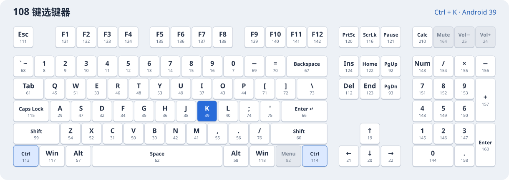

# 使用手册

[返回项目首页](../README.md) · [故障排查](TROUBLESHOOTING.md)

## 选对键盘设置入口

在 HyperKey 首页可以直接打开两类系统设置。也可以从平板「设置 → 手写笔与键盘」进入小米专属键盘，再打开「键盘快捷键」；通用入口在系统的实体键盘设置里。菜单名称随固件和键盘连接状态可能不同。

| 页面 | 在这里改什么 |
| --- | --- |
| 通用实体键盘 | 总开关、各组全局开关，以及模块管理入口 |
| 小米平板专属键盘 → 键盘快捷键 | 系统原有的十个开关和原生组合键编辑；模块补齐窗口、任务键等项目 |
| HyperKey 首页 | 相同的全局开关，以及应用名单、映射、按键测试、语言与外观 |

首次加载会读入系统里已经关闭的项目。之后修改全局单项会双向同步，保留用户在原生编辑器里定义的组合键。总开关名称是**「关闭所有系统快捷键」**：打开表示禁用。此时单项变灰，但它们的勾选状态会保留。这里的「所有」指下表中的 19 项，不影响编辑器自身的 `Ctrl+C` 等应用内快捷键。

| 项目组 | 可控制的项目 |
| --- | --- |
| 系统快捷键（10） | 关闭窗口、区域截屏、截全屏、锁屏、回到桌面、全局搜索、最近任务、Alt+Tab 切换应用、通知中心、控制中心 |
| 窗口操作（4） | 小窗、全屏、向左或向右进入分屏 / 调整分屏比例 |
| 任务键（3） | 单击显示任务栏、双击切最近应用、长按显示快捷键面板 |
| 其他（2） | Esc 的系统操作、打开应用的组合键；后者是聚合开关，会一起改变已有启动应用快捷键的启用状态 |

## 只屏蔽触控板三指下滑截屏（0.3.2 起）

打开 HyperKey 首页的「屏蔽触控板三指下滑截屏」，或到通用实体键盘、小米专属键盘的「键盘快捷键」页面，在「触控板」组开启同一个开关。默认关闭；它独立于 19 项键盘开关和应用名单。升级后需重启一次以加载系统 Hook，之后切换开关对下一次手势生效。关闭开关或恢复模块默认设置可还原。

验证时分别在**键盘触控板**和**平板屏幕**上三指下滑。只有前者的全屏截屏应被屏蔽。若系统把三指下滑配置为其他动作，模块不拦截该动作；键盘、实体按键截屏与三指上滑不在这个开关的作用范围。

## 按应用使用不同的规则

打开「应用名单」，搜索应用名称或包名，通过图标确认目标。没有启动入口的应用可手动输入完整包名。最多可添加 128 个应用；未加入的应用跟随全局。分屏时，以**当前获得键盘焦点的应用**为准。

- 全局总禁用开启时，任何应用的「允许」都不会触发这些系统动作。
- 全局总禁用关闭时，可以给单个应用选「全部允许」「全部禁用」或逐项覆盖。例如全局关闭「回到桌面」，仍可只在一个应用里允许它。
- 单项选「跟随全局」会跟随以后对全局的修改。暂停配置可临时回到全局规则；移出名单也会删除该应用的专属映射。

**例：只在远程桌面里把 Win 交给远端。** 保持全局总禁用关闭，给远程客户端添加应用配置，开启「Win 原始按键透传」。切回客户端并点一下远程会话使其获得焦点，再测试 `Win` 和 `Win+D`。如客户端提供键盘捕获选项，也需要允许它把组合键发给远端。离开客户端后，平板继续使用原来的全局设置。本项目已验证本地应用收到 Win 的按下和抬起，尚未实测 RDP 或 Moonlight 的远端接收结果。

## 按键映射

首页的「按键映射」管理全局规则；从「应用名单 → 某个应用 → 按键映射」进入，只改该应用。在 0.3.1 的来源或目标中点「108 键 + Fn」，依次点键帽（再点一次取消），核对底部预览，点「使用此组合」，再「保存映射」。实体录入时，按住整组键，最后按触发键；松开其中任意一键即可确认。要单独绑定右 Ctrl，清空后只选右 Ctrl。

- **多个修饰键：** 例如 `Ctrl + Shift + K` 或 `Fn + Ctrl + K`。Fn 位于 Esc 右侧，Android 键值 119。若键盘在硬件中处理 Fn 层，只向 Android 发送转换后的键，则只能绑定实际收到的键。可在「按键测试」检查 Fn 键帽或 Fn 修饰标记。
- **多个普通键：** 最多 8 个普通键，另可加修饰键。例如 `A + B + C`：按住 A、B（两者顺序不限），最后按 C 触发。前置键仍会正常发送给应用，所以文本编辑器可能先输入 `ab`。两条同优先级规则同时匹配且前置键数量相同，模块放行触发键，避免误执行。
- **目标组合：** 例如将 `F8` 映射为 `Ctrl + J + K`。按住 F8 时目标依次按下，松开时反序抬起。全局与应用专属规则都支持；升级会保留已保存的映射。

键帽上方是名称、下方是 Android 键值。主键盘 Enter（66）和小键盘 Enter（160）可分别映射。在窄屏可切换主键区、导航区、数字区或左右滑动；「搜索键值」也能找到实体布局之外的可映射按键。灰色的 Menu、静音及音量键为保留键。仍可用「实体键录入」直接录组合；触发已保存规则需要实体字母键盘。

| 目标 | 触发效果 |
| --- | --- |
| 目标键 / 系统动作 | 替换为目标键或组合，或触发所选 HyperOS 动作。 |
| 打开应用 | 在当前 Android 用户下打开所选应用的启动入口。 |
| 打开功能 | 选择系统页面（例如蓝牙），或选应用，再选它公开且 HyperKey 有权打开的 Activity。私有页面不可选；要求额外参数或登录的页面由对方应用处理。 |
| 普通命令 | 在 HyperKey 应用 UID 下执行输入的 shell 文本，不自动申请 Root，也不具有 ADB shell 身份。例如可用 `pwd` 验证完成提示。 |
| Root 命令 | 每次触发先展示完整命令，点「检测 Root 并运行」。未安装 su、拒绝授权、UID 不为 0 都不会发送命令，也不会降级执行。 |

每次按下只触发一次；重复按键不会重复执行动作。命令不支持交互式输入，不保存或展示标准输出；反馈显示完成、失败退出码、拒绝或超时。等待授权和命令完成共用 30 秒。命令可写多行（最多 2048 字符）；锁屏期间不启动自定义动作。

| 例子 | 设置方法 | 验证方法 |
| --- | --- | --- |
| 仅在某编辑器中让 Caps Lock 变为 Ctrl | 在编辑器的专属映射中录入 Caps Lock，目标选择左 Ctrl | 回到编辑器选中文字，按住 Caps Lock 再按 C，随后粘贴核对 |
| 用新的组合键截全屏 | 在全局或某个应用中录入新组合键，目标选择系统动作「截全屏」 | 在目标应用中按新组合键；若只需新组合，再关闭原来的「截全屏」单项 |

同一范围内再次保存相同来源会替换旧规则；同一来源同时存在于应用和全局规则时，优先使用已启用的应用规则。映射输出不再触发下一条映射。全局总禁用会暂停所有动作目标（包括启动和命令），键到键映射仍然生效。应用明确开启「Win 原始按键透传」时，Win 与 Win 组合优先交给该应用，不触发对应映射。Alt+Tab 会话、任务键手势和「打开应用」聚合项不能作为映射目标。仅处理实体字母键盘；不支持映射电源等保留按键。

## 看懂按键测试

进入「按键测试」后按住 Win，再按 D。被按住的键帽会高亮，放开后保留上次组合；可对照 Android 键值、扫描码和修饰位。在已验证的键盘上，左 Win 的 Android 键值是 `117`，D 是 `32`。下面的列表最多显示最近 16 条按下、重复或松开事件，点「清空」或离开页面即可清除。

系统 Hook 生效时，**测试页会自己接收 Win，即使普通应用仍允许 Win+D 返回桌面**。因此，测试页适合确认应用收到什么键；要验证桌面动作或应用专属规则，请回到对应应用测试。

## 隐藏或恢复桌面图标（0.2.1 起）

打开「HyperKey → 语言与外观 → 隐藏桌面图标」。默认关闭，切换不需要额外授权或重启。要恢复图标，从「LSPosed → 模块 → HyperKey → 模块设置」重新打开应用，关闭同一开关即可。通用键盘和小米专属键盘的「模块管理 → 打开 HyperKey」也能进入；该入口需对应系统设置宿主已加载新版模块。部分桌面刷新图标会有延迟，也可能保留一个只打开「应用信息」的系统入口。

## 语言、主题与颜色

「语言与外观」支持跟随系统、简体中文和 English，其他系统语言回退为英文。主题可跟随系统，或固定为浅色、深色。强调色可选 Miuix 默认色、壁纸取色（Android 12 及以上，取决于系统主题）、Material 色板（9 种色相，200 / 500 / 700 三档）或输入六位 HEX，例如 `#1976D2`。选择色块或输入值后先看预览，点「应用」才保存。更改会作用于 HyperKey 的各个页面；系统设置内的原生控件继续跟随宿主的语言和主题。
